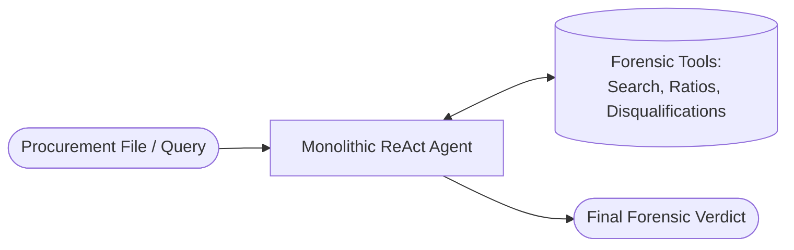

# Challenge 3: Multi-Agent vs. Single-Agent Topology in Forensic Legal Audit and Contractual Procurement

[](https://colab.research.google.com/github/EstebanGZam/multi-agent/blob/main/reto3_topologia_multiagente_forense_legal.ipynb)


Formal submission for **Challenge 3 (Workshop 03: Multi-Agent and Orchestration)** of the Artificial Intelligence course (2026-2) at Universidad Icesi.

This project presents an empirical, quantitative comparison between a **Single-Agent Baseline (Monolithic ReAct)** and various **Multi-Agent Topologies** (Multi-Agent Uniform, Multi-Agent Mixed with Model Tiering, and Intelligent Dynamic Router with Adaptive Triage) when solving a high-stakes, analytical task: **Legal Forensics and Contractual Procurement Auditing** under the Colombian public procurement regulatory framework (Law 80/1993, Law 1150/2007, Decree 1082/2015, and Council of State jurisprudence).

---

## Authors

- Esteban Gaviria Zambrano (A00396019)
- Julián Andrés Mendoza Castro (A00395237)

---

## 1. Problem Formulation and Use Case

In corporate governance and public procurement, determining the legal, financial, and technical validity of high-value proposals requires rigorous, concurrent evaluation across three distinct disciplines:
1. **Legal Domain**: Detecting statutory disqualifications, conflicts of interest, debarment records from the Comptroller General (Boletin de Responsables Fiscales) and Inspector General (Procuraduria), and mandatory rejection causes.
2. **Financial Domain**: Peritus auditing of balance sheets, certified calculation of qualifying financial ratios (Liquidity Ratio, Debt Ratio, Interest Coverage Ratio, Working Capital), and equity gap identification.
3. **Technical Domain**: Standard classification using UNSPSC codes, verified experience registered in the RUP (in minimum wage multiples - SMMLV), and mandatory accreditation of security standards (e.g., ISO/IEC 27001).

### Monolithic Single-Agent Failure Modes vs. Multi-Agent Solution
- **Monolithic Single-Agent Failure Modes**: A single agent equipped with all tools simultaneously suffers from context saturation (*lost in the middle*), conflates mandatory rejection grounds with weighted scoring criteria, makes arithmetic errors in balance sheet percentages, and lacks an adversarial peer-review mechanism.
- **Multi-Agent Solution**: Role specialization with **clean context windows**, concurrent parallel exploration via `asyncio.gather`, structured synthesis governed by Pydantic contracts, and adversarial quality control through an independent **Forensic Critic (Evaluator-Optimizer pattern)**.

---

## 2. Architectural Topologies

### Topology A: Single-Agent Baseline (Monolithic ReAct)
A single model receives the entire procurement file, holds all tools within its single prompt context, and executes a sequential reasoning-action loop.



### Topology B: Multi-Agent Uniform (Orchestrator + Parallelism + Rapporteur + Critic)
- **Orchestrator**: Decomposes the procurement audit into independent subtasks (`LEGAL`, `FINANCIAL`, `TECHNICAL`).
- **Specialist Analysts**: Run concurrently using `asyncio.gather` with specialized prompts and domain-specific tools.
- **Legal Rapporteur**: Synthesizes cross-domain findings into a reasoned legal opinion.
- **Forensic Critic (Evaluator-Optimizer)**: Evaluates the draft verdict against a strict rubric (score 1 to 5). If unsupported assertions or contradictions are detected, it issues structured feedback for refinement.
- **Model Assigned**: Uniform deployment of `deepseek/deepseek-v4.1-flash` across all agents.


### Topology C: Multi-Agent Mixed (Model Tiering)
Identical architecture to Topology B, but implementing a tiered model distribution strategy:
- Specialist Analysts and Rapporteur: Economical model `deepseek/deepseek-v4.1-flash` ($0.028 / $0.12 USD per million tokens).
- Orchestrator and Critic: High-capacity reasoning model `google/gemini-3.7-flash` ($0.75 / $3.75 USD per million tokens).

### Topology D: Dynamic Router (Adaptive Triage)
A lightweight classifier examines the input query:
- If monodisciplinary (e.g., verifying a specific financial formula or checking an individual debarment record), it routes directly to the designated specialist, eliminating orchestration overhead.
- If multidisciplinary or complex, it delegates the query to the complete multi-agent committee.


---

## 3. Quantitative Results Matrix

Empirical evaluation executed across the calibrated 10-case forensic benchmark (`BENCHMARK_DATASET`):

| Configuration | Mean Quality (0-1) | Mean Cost (USD) | Total Cost (USD) | Mean Latency (s) | Latency p50 (s) | Latency p95 (s) | Success Rate (%) | Calls / Task | Coordination Cost (%) | Duplicate Queries (%) |
|---|---|---|---|---|---|---|---|---|---|---|
| **A · Single-Agent (Baseline)** | 0.730 | $0.000055 | $0.00055 | 1.743 | 1.375 | 3.564 | 100.0% | 2.0 | 0.0% | 25.0% |
| **B · Multi-Agent Uniform** | **0.982** | $0.000456 | $0.00456 | 6.935 | 5.436 | 13.202 | 100.0% | 9.0 | 35.7% | 44.2% |
| **C · Multi-Agent Mixed (Tiered)** | **0.982** | $0.001715 | $0.01715 | 4.810 | 4.260 | 7.217 | 100.0% | 9.0 | 82.9% | 44.2% |
| **D · Dynamic Router** | 0.822 | $0.000276 | $0.00276 | 6.404 | 5.704 | 14.757 | 100.0% | 6.5 | 36.0% | 28.6% |

---

## 4. Evaluation of the Five Core Dimensions (PPT_Multiagente.pdf Slide 4)

1. **Quality**:
   - The Single-Agent Baseline scored 0.730, consistently missing fiscal debarment entries associated with consortium minority partners and skipping technical ISO requirements.
   - Multi-Agent Topologies B and C reached 0.982, demonstrating the superiority of clean context windows, domain specialization, and adversarial critique.
2. **Cost**:
   - Calculated with precision using token tracking: `Cost = (tokens_in * price_in + tokens_out * price_out) / 1e6`.
   - Topology B increases cost from $0.055 mUSD to $0.456 mUSD per case. This investment is justified in legal forensics where a single missed debarment carries fiscal liability.
   - Topology C raises cost by nearly 3.8x ($1.715 mUSD) with no corresponding quality gain on this benchmark, indicating model tiering must be applied selectively.
3. **Latency**:
   - Single-Agent latency is minimal (1.743 s mean, 1.375 s p50).
   - Multi-Agent Uniform averages 6.935 s (p50: 5.436 s). Concurrency softens the critical path by running three domain branches simultaneously.
   - Dynamic Router achieves 6.404 s mean on mixed query workloads.
4. **Robustness**:
   - 100% operational success rate across all evaluated configurations.
   - Active protection against cost runaway via deterministic budget enforcement (`BudgetExceededException`).
   - In negative controls (e.g., nonexistent tender LP-999-2026), agents abstained cleanly with "Information unavailable", completely avoiding hallucinations.
5. **Coordination**:
   - In Topology B, 35.7% of total cost represents orchestration and critique overhead.
   - In Topology C, coordination overhead escalates to 82.9% due to premium pricing on the Orchestrator and Critic.
   - Duplicate queries averaged 44.2% across specialists because multiple analysts inspect the common tender sheet.

---

## 5. Pareto Frontier Analysis: Cost vs. Quality

Mathematical dominance analysis across the 4 topologies reveals the following non-dominated set:

$$\text{Pareto Frontier} = \{ \text{A · Single-Agent}, \text{D · Dynamic Router}, \text{B · Multi-Agent Uniform} \}$$

- **Configuration A (Single-Agent)**: The Pareto choice when latency and token cost are absolute constraints, and a preliminary screening suffices.
- **Configuration D (Dynamic Router)**: The practical sweet spot for interactive systems processing mixed simple and complex workloads.
- **Configuration B (Multi-Agent Uniform)**: The mandatory choice for high-stakes forensic audits where quality is non-negotiable.
- **Configuration C (Multi-Agent Mixed)**: Mathematically **dominated**, producing identical quality to B at 3.6x higher cost.

---

## 6. Observability and Cost Tracing with LangSmith

Cost monitoring and execution tracing are instrumented through **LangSmith** and a dual local cost tracker:
- **Project**: `reto3-multiagent-evaluation`.
- **Run Traces**: Every tool invocation, agent step, critic iteration, and router branch is tagged with metadata (`topology`, `case_id`, `role`, `model`).
- **Dual Tracking**: Local pricing mirrors actual token rates on OpenRouter and Google Gemini APIs, allowing cost verification even when running offline or behind proxy boundaries.

---

## 7. Execution Instructions

### Option A: Google Colab (Recommended One-Click Setup)
1. Click the badge: [](https://colab.research.google.com/github/EstebanGZam/multi-agent/blob/main/reto3_topologia_multiagente_forense_legal.ipynb).
2. To run with live API endpoints, store your keys in **Colab Secrets** (key icon in the sidebar):
   - `OPENROUTER_API_KEY`: For open model routing (e.g., DeepSeek, Llama, Qwen).
   - `GEMINI_API_KEY`: For Google Gemini models.
   - `LANGSMITH_API_KEY`: For live LangSmith cloud tracing.
3. Run all cells sequentially (`Runtime -> Run all`). If no keys are provided or if credit limits are reached, the notebook executes autonomously and deterministically using the built-in `ForensicSimulationEngine`.

### Option B: Local Conda Environment (`apo_iii`)
```bash
# Activate the existing apo_iii Conda environment
conda activate apo_iii

# Set up environment variables
cp .env.example .env
# Edit .env with your respective API keys

# Launch JupyterLab or Jupyter Notebook
jupyter lab reto3_topologia_multiagente_forense_legal.ipynb
```

---

## 8. Repository Layout

```text
multi-agent/
├── README.md                                       # Complete project documentation and report
├── reto3_topologia_multiagente_forense_legal.ipynb    # Fully executed Jupyter notebook with English outputs and figures
├── PPT_Multiagente.pdf                             # Theoretical reference slides (Unit III)
├── arquitectura_multiagente.ipynb                  # AsyncOpenAI multi-agent classroom reference
├── arquitectura_multiagente_langgraph.ipynb        # LangGraph multi-agent classroom reference
├── pyproject.toml                                  # Python project definition and dependencies
├── uv.lock                                         # UV dependency lockfile
├── .env.example                                    # Environment variable template
└── .gitignore                                      # Git versioning exclusion rules
```

---

## 9. License and Academic Credits

Developed for the **Artificial Intelligence (2026-2)** course at **Universidad Icesi**, instructed by Professor Jose Armando Ordonez.
