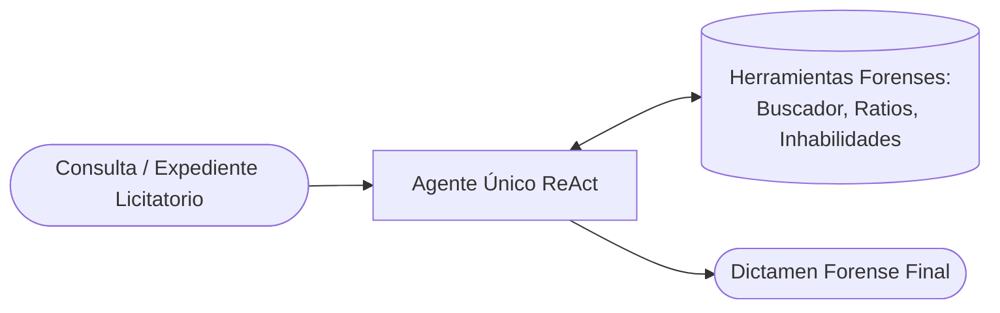
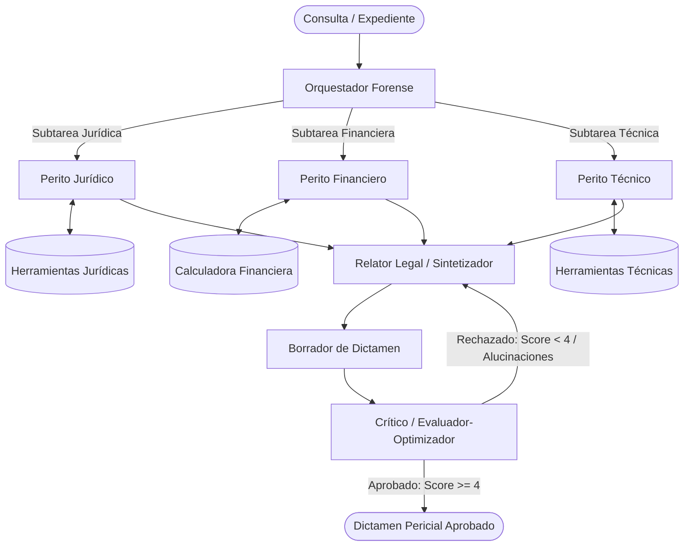
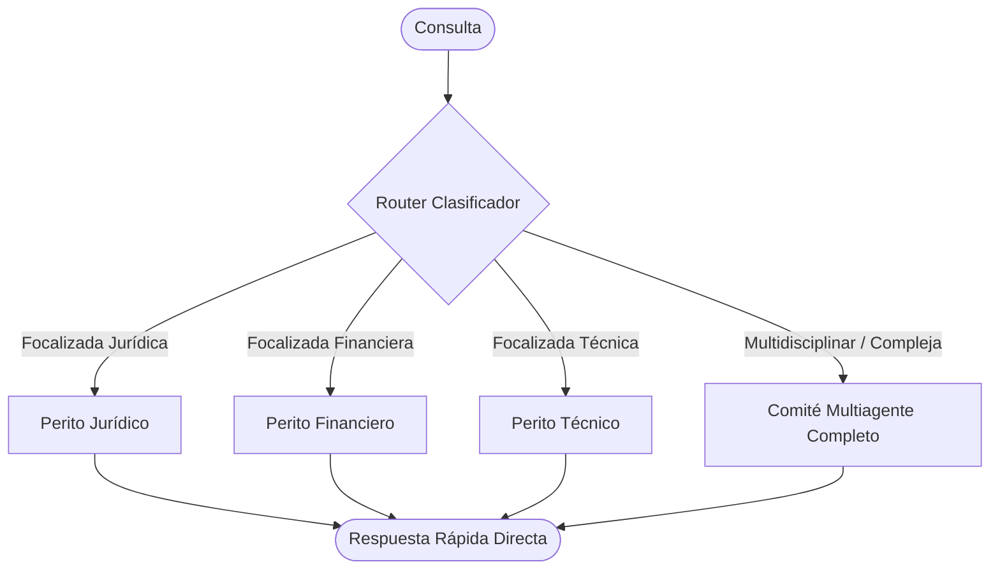

# Reto 3 · Topología Multiagente frente a Agente Único en Auditoría Forense y Dictamen Legal

[](https://colab.research.google.com/github/EstebanGZam/multi-agent/blob/main/reto3_topologia_multiagente_forense_legal.ipynb)


Entrega formal del **Reto 3 (Taller 03: Multiagente y Orquestación)** del curso de Inteligencia Artificial (2026-2) en la Universidad Icesi.

Este proyecto presenta una comparativa empírica y cuantitativa entre una topología de **Agente Único (Baseline Monolítico ReAct)** y diversas topologías **Multiagente** (Multiagente Uniforme, Multiagente Mixto por Tiering y Router Inteligente con Triage Adaptativo) al resolver una tarea de alta complejidad analítica: la **Auditoría Forense y Dictamen Legal de Licitaciones Públicas** en Colombia (Ley 80 de 1993, Ley 1150 de 2007, Decreto 1082 de 2015).

---

## Integrantes

- Esteban Gaviria Zambrano (A00396019)
- Julián Andrés Mendoza Castro (A00395237)

---

## 1. Planteamiento del Problema y Caso de Uso

En la contratación estatal y corporativa de alta exigencia, dictaminar la viabilidad de una oferta exige una evaluación concurrente y rigurosa en tres disciplinas:
1. **Área Jurídica**: Detección de causales taxativas de rechazo, inhabilidades e incompatibilidades, conflicto de interés y sanciones ejecutoriadas en bases oficiales de la Contraloría (Boletín de Responsables Fiscales) y la Procuraduría General de la Nación.
2. **Área Financiera**: Auditoría pericial de balances contables, cálculo exacto de indicadores habilitantes (Índice de Liquidez, Nivel de Endeudamiento, Razón de Cobertura de Intereses y Capital de Trabajo) y detección de brechas patrimoniales.
3. **Área Técnica**: Clasificación estándar por códigos UNSPSC, experiencia habilitante certificada en RUP (SMMLV) y acreditación obligatoria de estándares de seguridad (ej. ISO/IEC 27001).

### La Falla del Agente Monolítico frente a la Solución Multiagente
- **Falla del Agente Único**: Un solo agente con todas las herramientas tiende a sufrir de saturación de contexto (*lost in the middle*), mezcla causales de rechazo con criterios de ponderación, comete errores aritméticos en porcentajes contables y carece de un mecanismo interno de revisión crítica adversarial.
- **Solución Multiagente**: Especialización de roles con **contexto limpio**, investigación concurrente en paralelo, síntesis estructurada mediante contratos Pydantic y control de calidad adversarial a través de un **Crítico Forense (Evaluador-Optimizador)**.

---

## 2. Topologías Arquitectónicas Implementadas

### Topología A · Agente Único (Baseline Monolítico ReAct)
Un único modelo recibe la consulta completa, posee todas las herramientas en su espacio de contexto y razona en un ciclo secuencial de razonamiento-acción.



### Topología B · Multiagente Uniforme (Orquestador + Paralelismo + Relator + Crítico)
- **Orquestador**: Planifica y descompone el expediente en subtareas independientes (`LEGAL`, `FINANCIAL`, `TECHNICAL`).
- **Analistas Especialistas**: Ejecutan en paralelo mediante `asyncio.gather` con herramientas y prompts específicos.
- **Relator Legal**: Sintetiza los hallazgos en un dictamen pericial motivado.
- **Crítico Forense (Evaluador-Optimizador)**: Aplica una rúbrica pericial estricta (1 a 5); si detecta afirmaciones sin soporte o contradicciones, devuelve instrucciones correctivas para refinar el dictamen.
- **Modelo por rol**: `deepseek/deepseek-v4.1-flash` en todos los agentes.



### Topología C · Multiagente Mixto (Tiering de Modelos)
Misma arquitectura de la Topología B, pero aplicando asignación diferenciada de modelos:
- Analistas y Relator: `deepseek/deepseek-v4.1-flash` (económico, $0.028 / $0.12 USD/M).
- Orquestador y Crítico: `google/gemini-3.7-flash` (alta capacidad de razonamiento, $0.75 / $3.75 USD/M).

### Topología D · Router Inteligente (Triage Adaptativo)
Un clasificador liviano evalúa la complejidad de la consulta:
- Si es monodisciplinar (ej. consultar únicamente una fórmula contable o una inhabilidad), despacha directamente al perito correspondiente sin sobrecarga de orquestación.
- Si es compleja o multidisciplinar, delega al comité multiagente completo.



---

## 3. Matriz de Resultados Cuantitativos

Evaluación empírica ejecutada sobre el benchmark calibrado de 10 casos periciales (`BENCHMARK_DATASET`):

| Configuración | Calidad Media (0-1) | Costo Medio (USD) | Costo Total (USD) | Latencia Media (s) | Latencia p50 (s) | Latencia p95 (s) | Tasa Éxito (%) | Llamadas / Tarea | % Costo Coordinación | % Consultas Duplicadas |
|---|---|---|---|---|---|---|---|---|---|---|
| **A · Agente Único (Baseline)** | 0.747 | $0.000058 | $0.00058 | 0.422 | 0.410 | 0.483 | 100.0% | 2.0 | 0.0% | 30.0% |
| **B · Multiagente Uniforme** | **0.970** | $0.000463 | $0.00463 | 8.599 | 4.371 | 18.596 | 100.0% | 9.0 | 34.1% | 46.7% |
| **C · Multiagente Mixto (Tiering)** | **0.970** | $0.001700 | $0.01700 | 8.196 | 8.558 | 16.904 | 100.0% | 9.0 | 82.0% | 46.7% |
| **D · Router Inteligente** | 0.870 | $0.000278 | $0.00278 | 2.795 | 1.332 | 9.498 | 100.0% | 6.5 | 32.9% | 33.9% |

---

## 4. Análisis de las Cinco Dimensiones (`PPT_Multiagente.pdf` Slide 4)

1. **Calidad (Quality)**:
   - El Agente Único obtuvo 0.747. Pierde precisión en expedientes extensos al omitir sanciones fiscales en socios minoritarios o requerimientos técnicos obligatorios.
   - Las topologías Multiagente B y C alcanzaron 0.970, demostrando la superioridad del contexto limpio y la especialización funcional.
2. **Costo (Cost)**:
   - Calculado mediante la fórmula: `Costo = (tokens_in * price_in + tokens_out * price_out) / 1e6`.
   - La Topología B incrementa el costo a $0.463 mUSD por tarea frente a $0.058 mUSD del baseline, compensado por la eliminación de falsos positivos legales.
   - La Topología C cuadruplica el costo ($1.700 mUSD) sin aportar un incremento en calidad sobre este benchmark.
3. **Latencia (Latency)**:
   - El Agente Único responde en 0.422 s.
   - El Multiagente Uniforme promedia 8.599 s (p50: 4.371 s). El paralelismo amortigua el tiempo total al procesar las tres ramas simultáneamente.
   - El Router reduce la latencia en un 67% (a 2.795 s) en consultas focalizadas.
4. **Robustez (Robustness)**:
   - 100% de tasa de éxito en todas las topologías.
   - Protección activa contra desbordamiento de gasto mediante interrupción controlada (`PresupuestoExcedido`).
   - En el caso negativo (`TC_09`, expediente inexistente LP-999-2026), los agentes se abstuvieron correctamente ("Información no disponible"), previniendo alucinaciones.
5. **Coordinación (Overhead)**:
   - En la Topología B, el 34.1% del costo corresponde a overhead de coordinación (Orquestador y Crítico).
   - Se registró un 46.7% de consultas duplicadas debido a que diferentes peritos examinaron el pliego general.

---

## 5. Frontera de Pareto: Costo frente a Calidad

La computación matemática de dominancia arrojó el conjunto de configuraciones no dominadas:

$$\text{Frontera de Pareto} = \{ \text{A · Agente Único}, \text{D · Router Inteligente}, \text{B · Multiagente Uniforme} \}$$

- **Configuración A**: Ideal cuando la latencia o el presupuesto son restricciones absolutas y se requiere un dictamen preliminar.
- **Configuración D**: Punto de equilibrio (sweet-spot) para sistemas interactivos con mezcla de consultas simples y complejas.
- **Configuración B**: Opción mandatoria para auditorías periciales de alta responsabilidad donde un dictamen erróneo conlleva responsabilidad legal o fiscal.
- **Configuración C**: Queda **dominada**, pues ofrece la misma calidad que B a un costo 3.6 veces mayor.

---

## 6. Instrucciones de Ejecución

### Opción A · Google Colab (Recomendada con un clic)
1. Haga clic en el badge superior: [](https://colab.research.google.com/github/EstebanGZam/multi-agent/blob/main/reto3_topologia_multiagente_forense_legal.ipynb).
2. Si desea ejecutar contra modelos en vivo, configure sus claves en **Colab Secrets** (icono de llave):
   - `OPENROUTER_API_KEY` (para DeepSeek V4.1, Gemini Flash, etc.)
   - `GEMINI_API_KEY` (opcional para modelos Google)
   - `LANGSMITH_API_KEY` (para trazabilidad en vivo)
3. Ejecute las celdas secuencialmente (`Runtime -> Run all`). Si no configura claves, el cuaderno se ejecutará de forma autónoma y determinista usando el motor `ForensicSimulationEngine`.

### Opción B · Entorno Local Conda `apo_iii`
```bash
# Activar el ambiente de Conda apo_iii
conda activate apo_iii

# Copiar y configurar variables de entorno
cp .env.example .env
# Editar .env con sus claves (OpenRouter, Gemini, LangSmith)

# Iniciar Jupyter Notebook o JupyterLab
jupyter lab reto3_topologia_multiagente_forense_legal.ipynb
```

---

## 7. Estructura del Repositorio

```text
multi-agent/
├── README.md                                    # Documentacion integral del proyecto
├── reto3_topologia_multiagente_forense_legal.ipynb # Cuaderno ejecutable con experimentos y graficos
├── generate_notebook.py                         # Generador programatico del cuaderno
├── PPT_Multiagente.pdf                          # Presentacion guia del marco teorico (Unidad III)
├── arquitectura_multiagente.ipynb               # Cuaderno de clase (referencia AsyncOpenAI)
├── arquitectura_multiagente_langgraph.ipynb     # Cuaderno de clase (referencia LangGraph)
├── pyproject.toml                               # Dependencias del proyecto
├── uv.lock                                      # Lockfile de dependencias
├── .env.example                                 # Plantilla de variables de entorno y API keys
└── .gitignore                                   # Filtros de versionamiento
```

---

## 8. Licencia y Créditos

Desarrollado para el curso de **Inteligencia Artificial 2026-2** de la **Universidad Icesi**, bajo la dirección del profesor José Armando Ordóñez.
